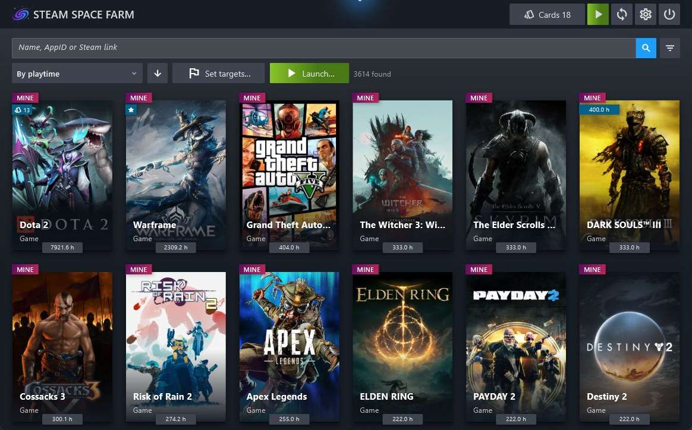

<h1 align="center">SteamSpaceFarm</h1>

<p align="center">
  
</p>

<p align="center">
  <a href="https://github.com/CarapacikSpace/SteamSpaceFarm/releases/latest"></a>
</p>

<p align="center">
  <a href="https://github.com/CarapacikSpace/SteamSpaceFarm/releases/latest">Latest release</a> · <a href="README.ru.md">Русский</a> · <a href="CHANGELOG.md">Changelog</a> · <a href="https://github.com/CarapacikSpace/SteamSpaceFarm/issues">Report an issue</a>
</p>

SteamSpaceFarm helps you manage your Steam library, collect trading cards, and reach playtime goals.



## Features and convenience

- **Your library in one place:** personal and Steam Family games, playtime, and last-played dates.
- **Playtime goals:** run up to **31 apps at once** or use a sequential queue; set automatic stop targets for individual games or a selection.
- **Trading cards:** check remaining drops and start farming. Card tasks take priority, then waiting playtime sessions resume.
- **Quick navigation:** search by name, AppID, or Steam link; filters, sorting, favorites, and context menus.
- **Your preferred look:** four card styles with current Steam artwork; English, Russian, Spanish, and Simplified Chinese.
- **Sign in once:** QR code or account name and password, with Steam Guard support and a protected saved session.

## Get started

1. Download the latest **Windows x64** release using the button above.
2. Extract the **entire archive** and run `ssf.exe`.
3. Open **Settings → Steam integration**, sign in, and load your library.

For cards, click **Check card drops** beside the library refresh button, then the green play button. **Cards N** shows the remaining count; click it to check again. The **With card drops** filter shows eligible games. Steam determines when cards drop and how playtime is recorded.

## Settings

Open the gear button at the top right. Changes save immediately.

**Appearance:** select the language and card style — Library capsule, Store header, Main capsule, or App icon.

**Library and sessions:** all four switches are on by default. Previously saved choices are preserved.

| Setting | When enabled | When disabled |
| --- | --- | --- |
| Refresh library on startup | Show the cached library immediately and refresh it in the background. | Refresh manually when needed. |
| Go invisible when starting games | Switch to Invisible and restore the previous status after all games stop. | SSF does not change your status. |
| Run without the Steam client open | Use SteamKit with your SSF sign-in. | Use Steamworks; keep the local Steam client open on the same account. |
| Update Steam playtime every hour | Briefly stop sessions, retrieve recorded time, and resume. | Skip hourly synchronization; session time continues to accumulate locally. |

**Card farming modes:** Fast (default) alternates group sessions with short individual runs; One at a time finishes one game before the next; Combined first builds up two hours across multiple games, then farms them individually.

**Steam integration:** sign in, refresh the library, clear its cache, or sign out. Clearing the cache removes local edits, favorites, and targets but keeps the saved sign-in; signing out clears both. Appearance stays accessible while games run or the library updates. Stop games before changing the launch method or Invisible option, refreshing the library, or signing out.

<details>
<summary>Local data and building from source</summary>

Data is stored in `%APPDATA%\CarapacikSpace\SteamSpaceFarm\`: `library/catalog.json`, `library/cards.json`, and the DPAPI-protected `steam/session.dpapi`.

Build requirements: Flutter stable with the Dart SDK specified in `ssf_flutter/pubspec.yaml`, .NET 10 SDK, and Visual Studio's **Desktop development with C++** workload with a Windows SDK. From the repository root in PowerShell:

```powershell
./tools/windows/build_steam_game.ps1
./tools/windows/build_steam_library_helper.ps1
cd ssf_flutter
flutter pub get
flutter gen-l10n
flutter analyze
flutter test
flutter build windows --release
```

The complete bundle is in `ssf_flutter/build/windows/x64/runner/Release/`. Build both helpers before Flutter. ARB translations are in `ssf_flutter/lib/src/localization/translations/`.

Offline helper checks, from the repository root:

```powershell
dotnet run --project ssf_game/RunnerChecks/RunnerChecks.csproj -c Release
dotnet run --project ssf_steam_helper/ssf_steam_helper.csproj -c Release -- --synthetic
```

</details>

## Feedback

[Report a bug or suggest a feature](https://github.com/CarapacikSpace/SteamSpaceFarm/issues), or join our [Discord server](https://discord.gg/Wy78VE6mdq). Include the app version and steps to reproduce; keep credentials and session files private.
