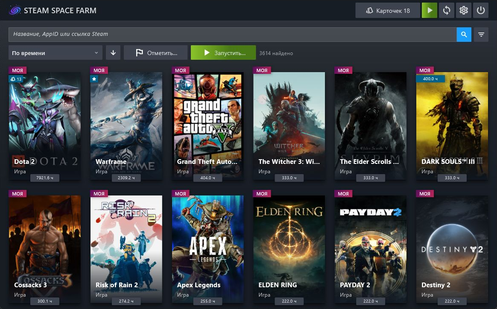

<h1 align="center">SteamSpaceFarm</h1>

<p align="center">
  
</p>

<p align="center">
  <a href="https://github.com/CarapacikSpace/SteamSpaceFarm/releases/latest"></a>
</p>

<p align="center">
  <a href="https://github.com/CarapacikSpace/SteamSpaceFarm/releases/latest">Последний релиз</a> · <a href="README.md">English</a> · <a href="CHANGELOG.md">История изменений</a> · <a href="https://github.com/CarapacikSpace/SteamSpaceFarm/issues">Сообщить об ошибке</a>
</p>

SteamSpaceFarm — приложение для управления библиотекой Steam, получения коллекционных карточек и достижения целей по игровому времени.



## Возможности и удобство

- **Вся библиотека под рукой:** личные игры и Steam Family, наигранное время и последний запуск.
- **Цели по времени:** до **31 приложения одновременно** или последовательная очередь; автоостановка для отдельных игр и выбранной группы.
- **Коллекционные карточки:** проверка оставшихся выпадений и запуск их получения. Карточки имеют приоритет, после них продолжаются ожидающие задания по времени.
- **Быстрая навигация:** поиск по названию, AppID или ссылке Steam; фильтры, сортировка, избранное и контекстные меню.
- **Внешний вид на ваш вкус:** четыре типа карточек с актуальными изображениями Steam; русский, английский, испанский и упрощённый китайский языки.
- **Вход один раз:** QR-код или логин и пароль, поддержка Steam Guard и защищённое сохранение сессии.

## Начало работы

1. Скачайте последний релиз для **Windows x64** кнопкой выше.
2. Распакуйте **весь архив** и запустите `ssf.exe`.
3. Откройте **Настройки → Интеграция Steam**, войдите в аккаунт и загрузите библиотеку.

Для получения карточек нажмите **Проверить карточки** рядом с обновлением библиотеки, затем зелёную кнопку запуска. **Карточек N** показывает остаток; повторное нажатие обновляет данные. Фильтр **С карточками** показывает подходящие игры. Момент выпадения карточек и учёт времени определяет Steam.

## Настройки

Откройте шестерёнку справа сверху. Изменения сохраняются сразу.

**Внешний вид:** язык и тип карточки — Library capsule, Store header, Main capsule или App icon.

**Библиотека и сеансы:** все четыре переключателя включены по умолчанию. Ранее сохранённый выбор сохраняется.

| Настройка | Если включена | Если выключена |
| --- | --- | --- |
| Обновлять библиотеку при запуске | Сразу показать кеш и обновить библиотеку в фоне. | Обновлять вручную по необходимости. |
| Переходить в «Невидимку» при запуске игр | Включить «Невидимку», а после остановки всех игр вернуть предыдущий статус. | SSF не меняет ваш статус. |
| Запуск без открытого клиента Steam | Использовать SteamKit; достаточно входа в SSF. | Использовать Steamworks; локальный клиент Steam должен быть открыт на том же аккаунте. |
| Обновлять время в Steam каждый час | Ненадолго остановить сеансы, получить записанное время и продолжить. | Не выполнять ежечасную сверку; время сеанса продолжает накапливаться локально. |

**Режимы получения карточек:** «Быстрый» (по умолчанию) чередует групповые и короткие одиночные запуски; «По одной» завершает одну игру перед следующей; «Комбинированный» сначала накапливает два часа в нескольких играх, затем получает карточки по одной игре.

**Интеграция Steam:** вход, обновление библиотеки, очистка кеша и выход. Очистка кеша удаляет локальные правки, избранное и цели, но сохраняет вход; выход из аккаунта очищает и кеш, и сессию. Внешний вид доступен во время работы игр и обновления библиотеки. Для смены способа запуска или «Невидимки», обновления библиотеки и выхода сначала остановите игры.

<details>
<summary>Данные приложения и сборка из исходников</summary>

Данные находятся в `%APPDATA%\CarapacikSpace\SteamSpaceFarm\`: `library/catalog.json`, `library/cards.json` и защищённая через DPAPI сессия `steam/session.dpapi`.

Для сборки нужны Flutter stable с Dart SDK из `ssf_flutter/pubspec.yaml`, .NET 10 SDK и Visual Studio с компонентами **Desktop development with C++** и Windows SDK. Из корня репозитория в PowerShell:

```powershell
./tools/windows/build_steam_game.ps1
./tools/windows/build_steam_library_helper.ps1
cd ssf_flutter
flutter pub get
flutter gen-l10n
flutter analyze
flutter test
flutter build windows --release
```

Полный комплект сборки — в `ssf_flutter/build/windows/x64/runner/Release/`. Сначала соберите оба helper, затем Flutter. ARB-переводы находятся в `ssf_flutter/lib/src/localization/translations/`.

Офлайн-проверки helper из корня репозитория:

```powershell
dotnet run --project ssf_game/RunnerChecks/RunnerChecks.csproj -c Release
dotnet run --project ssf_steam_helper/ssf_steam_helper.csproj -c Release -- --synthetic
```

</details>

## Обратная связь

[Сообщите об ошибке или предложите улучшение](https://github.com/CarapacikSpace/SteamSpaceFarm/issues) либо присоединяйтесь к нашему [Discord-серверу](https://discord.gg/Wy78VE6mdq). Укажите версию приложения и шаги воспроизведения; не публикуйте данные входа и файлы сессии.
